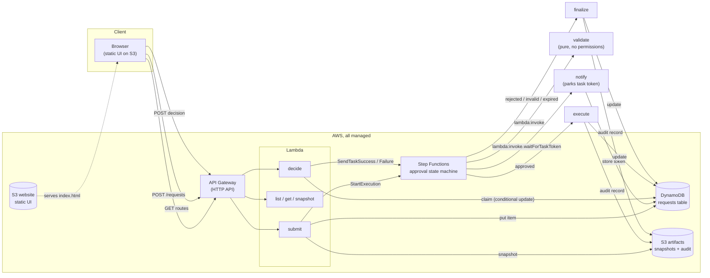
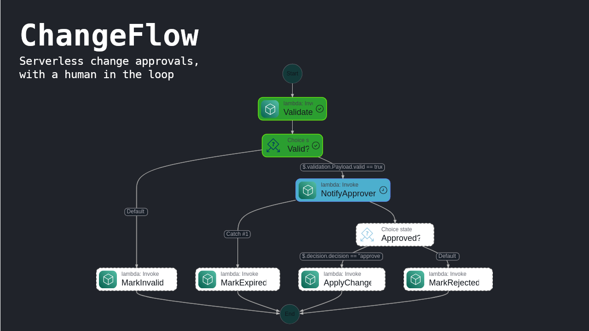

# ChangeFlow

**Serverless engineering-change approvals for teams that can't justify a PLM.**

Small product-development teams (garment, hardware, furniture - anywhere with parts and revisions) need change control: somebody proposes a change to a part, a human approves or rejects it, and the decision has to be auditable afterwards. Real PLM/ERP modules that do this cost five to six figures and need somebody to babysit them. A team of three does not need that. It needs a workflow that costs **$0 while idle** and still produces a frozen snapshot, an audit trail, and a clean approve/reject history.

ChangeFlow implements exactly that with five managed AWS services and nothing else - no servers, no containers, no pipelines to maintain after deploy.

## What it does, end to end

1. An engineer submits a change request (part number, title, description, impact) through a static web UI or `POST /requests`.
2. The request is **frozen** as a canonical JSON snapshot in S3 (like a frozen report snapshot in a PLM: the record can never be silently rewritten later) and persisted in DynamoDB.
3. A **Step Functions** state machine validates the request, then **pauses** and waits for a human decision using the `waitForTaskToken` callback pattern - the workflow sleeps for free until an approver answers.
4. An approver opens the request in the UI and clicks **Approve** or **Reject** (with name and comment). The API conditionally claims the decision (no double approvals, ever) and resolves the callback via `SendTaskSuccess`.
5. Approved requests are **executed** (terminal state + immutable audit record in S3); rejected, invalid or timed-out requests are closed the same way. The UI shows the full event timeline live.

## Architecture



| Service | Role | Why it fits |
| --- | --- | --- |
| **API Gateway** (HTTP API) | 4 routes: submit, list/get, decision, snapshot URL | Per-request pricing, zero cost when idle |
| **Lambda** (9 functions, Python 3.12 on Graviton arm64) | All compute | Scale to zero, per-function least-privilege IAM |
| **DynamoDB** | Single table `requests` with `status` GSI, on-demand billing, SSE | Millisecond reads for the UI, conditional updates prevent double approvals |
| **S3** | Frozen request snapshots, immutable audit records, hosts the static UI | The "write once, trust later" layer of the audit story |
| **Step Functions** | The actual workflow: validate, wait for human, branch, execute/close | The callback pattern replaces a long-running approval server |

### Visualisierte Step Functions State Machine



### The reusable pattern: `waitForTaskToken`

The heart of the build is a **human-in-the-loop approval without any server waiting around**:

- The state machine invokes the `notify` Lambda with `arn:aws:states:::lambda:invoke.waitForTaskToken` and a timeout (stack parameter, default 1 h).
- `notify` parks the task token on the DynamoDB item. The workflow now sleeps - it costs nothing while it waits.
- Any later HTTP call to `POST /requests/{id}/decision` can resolve it: the `decide` Lambda claims the request with a **conditional update** (`ConditionExpression: status = AWAITING_APPROVAL`), then sends `SendTaskSuccess` with the token.
- If nobody answers before the timeout, Step Functions throws `States.Timeout`, the state machine catches it and closes the request as `EXPIRED`. Timeouts are part of the workflow definition, not cron jobs you maintain.

This exact pattern (submit -> park token -> external system answers -> resume) is reusable for any approval, escalation or two-person-rule flow.

## Quick start

Prerequisites: AWS CLI configured, AWS SAM CLI, Python 3.12 (or Docker for `sam build --use-container`), `jq` for the smoke test.

```bash
sam build                         # or: sam build --use-container
sam deploy --guided               # stack name: changeflow, defaults are fine
./scripts/deploy-frontend.sh      # uploads UI and wires it to the API
./scripts/smoke-test.sh           # full end-to-end check via curl
```

`deploy-frontend.sh` reads the stack outputs, writes `frontend/config.js` with the API endpoint and syncs the UI to the website bucket. Open the printed `Website` URL, or open the API URL directly:

```bash
curl -X POST "$API/requests" -H 'content-type: application/json' -d '{
  "partNumber": "SHIRT-COLLAR-0042",
  "title": "Switch collar interfacing to supplier B",
  "description": "Supplier B uses a fused interlining; change spec and sample process.",
  "impact": "MEDIUM",
  "requestedBy": "Alex"
}'
```

While demoing, open the Step Functions console and watch executions of `changeflow-approval` move through `Validate -> NotifyApprover -> Approved? -> ApplyChange`.

### Local verification (no AWS account needed)

The workflow logic is fully testable before any deploy:

```bash
python3 tests/simulate_e2e.py
```

This walks the **real** state machine definition (extracted from `template.yaml`, not a copy) with a tiny ASL interpreter and runs all nine handlers against a fake boto3 (in-memory DynamoDB, S3 and Step Functions): approve path, reject path, invalid input, approval timeout, double-approval race safety and the API read handlers - 40+ assertions, zero cloud resources.

### Scale to zero

Everything here is on-demand or pay-per-request: DynamoDB `PAY_PER_REQUEST`, Lambda on arm64, HTTP API, S3, Step Functions state transitions. An idle stack's monthly bill is **$0**. At demo scale (a few hundred requests/month) it stays within or near the free tier. No EC2, no ECS, no containers, no cron, no maintenance window.

### Cleanup

```bash
aws s3 rm "s3://<stack>-artifacts-<account>" --recursive
aws s3 rm "s3://<stack>-site-<account>" --recursive
sam delete --stack-name changeflow
```

## Repo layout

```
template.yaml                 SAM template: all five services, IAM, outputs
statemachine/                 (inline in template.yaml as a Fn::Sub ASL definition)
src/submit|validate|notify|decide|execute|finalize|list|get|snapshot
frontend/                     Vanilla JS/CSS/HTML UI, served from S3, no build step
scripts/deploy-frontend.sh    Deploy UI + wire API endpoint
scripts/smoke-test.sh        End-to-end test: submit -> approve -> EXECUTED
tests/simulate_e2e.py         Full workflow simulation, runs without AWS
docs/submission.md            Challenge submission write-up
```

## Possible extensions (deliberately out of scope)

- SNS/SES notification instead of UI polling in the `notify` Lambda (one extra permission)
- Auto-approval lane for `impact=NONE` via an extra `Choice` state
- DynamoDB Streams to fan out executed changes into a downstream system
- CloudWatch alarms + X-Ray tracing baked into the template

The point of this entry was a tight, fully working end-to-end build - the extensions above are all one-step changes on top of the same pattern.
